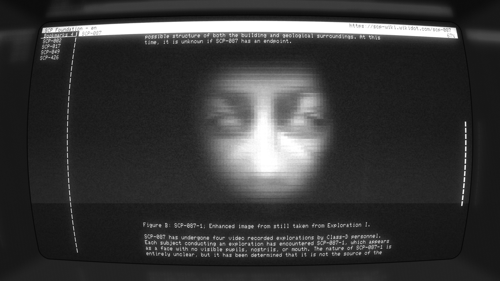
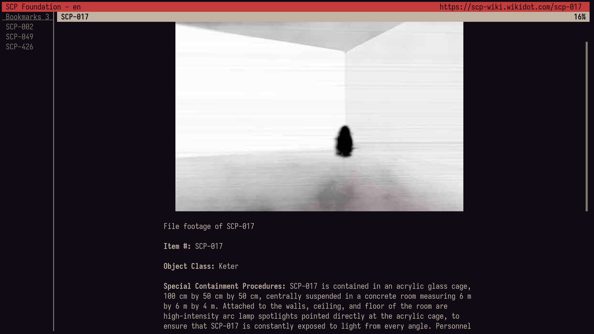
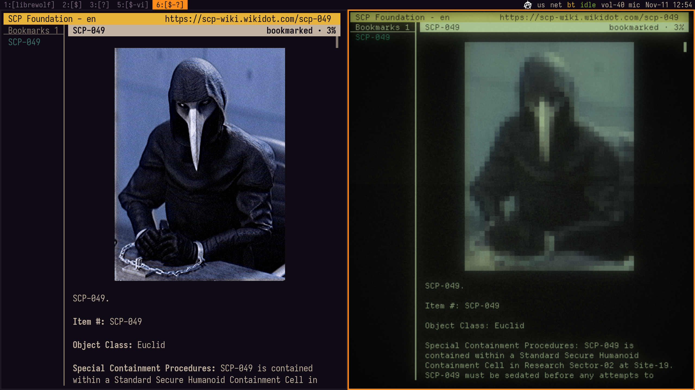

# raisa

A terminal client for the [SCP Wiki](https://scp-wiki.wikidot.com): articles, series lists, hubs and tales of 17 branches, with bookmarks, search and images right in the text. Named after RAISA, the Foundation's Records and Information Security Administration.


raisa in [cool-retro-term](https://github.com/Swordfish90/cool-retro-term)

- **Two columns.** Bookmarks on the left, the open page on the right; the text is centred and at most 80 characters wide. A narrow window shows one column, the focused one.
- **Like a browser.** `J`/`K` and `Enter` follow links, `p`/`N` and `n` go back and forward, and the reading position is remembered.
- **Images in the text**: Sixel (foot) or `▀` characters in other terminals; GIF animations play.
- **The object class at a glance**: the top line turns green (Safe), yellow (Euclid), red (Keter) or magenta (Thaumiel).
- **Hotkeys in any keyboard layout**, through the kitty keyboard protocol.
- **The Russian site** opens despite its Anubis check.

This is an unofficial program. The texts of the SCP Wiki belong to their authors and are licensed under [CC BY-SA 3.0](https://creativecommons.org/licenses/by-sa/3.0/); raisa only displays them.

How the code works: [docs/how-it-works.md](docs/how-it-works.md). What has changed: [CHANGES.md](CHANGES.md).

## Installing and running (Arch)

raisa needs Python 3.10 or newer and BeautifulSoup (`python-beautifulsoup4`, parses HTML). Optional: Pillow (`python-pillow`, images in the text), `librsvg` (SVG images) and `xdg-utils` (links in the browser, images in a viewer).

```sh
sudo pacman -S python-beautifulsoup4
sudo pacman -S python-pillow librsvg xdg-utils   # optional

bin/raisa               # run straight from the folder
bin/raisa 173           # open an article at once
bin/raisa -b ru         # the Russian branch
bin/raisa -b jp 001-jp
```

To run it as plain `raisa`, make a link: `ln -s "$PWD/bin/raisa" ~/.local/bin/raisa`. The man page reads straight from the folder: `man ./raisa.1`.

To install it system-wide, build the Arch Linux package (`makepkg -si`, the PKGBUILD is included) or use pip (`pip install .`).

## Options

| Option | What it does |
|---|---|
| `-b CODE` | the branch: `en cn cs de es fr it jp ko pl pt ru th ua vn zh int`; `en` by default |
| `target` | what to open: `173`, `scp-682-j`, `001-jp`, a page name or a URL |

One run reads one branch. A link to a page of another branch opens in the browser, and the top line says how to read it here: `raisa -b CODE`.

Without a target, raisa opens the last page of the branch at the same place; on the very first run, the main page.

## Keys

`raisa --help` and `man raisa` show the same list.

```
j/k, arrow keys           - scroll by a line
d/u, ^d/^u, PgDn/PgUp     - scroll by half a screen
Space                     - scroll by a whole screen
g/G, Home/End             - go to the top or the bottom
n, p/N                    - go to the next or the previous page or position
J/K                       - select the next or the previous link
Tab/Shift-Tab, h/l        - switch between the bookmarks and the text

Enter                     - open the selected link or bookmark
Esc                       - close the search

/                         - search the site
m                         - open the main page of the site
o                         - open the current page in the browser
i                         - open the image in an external viewer

b                         - bookmark the current page, or remove the bookmark
B                         - bookmark the selected link, or remove the bookmark
x                         - remove the selected bookmark

q                         - quit
```

## The screen


raisa in [foot](https://codeberg.org/dnkl/foot) terminal

The top line shows "SCP Foundation - en" (the branch code); on the right, messages, loading, and the address of the selected link or of the open page. The page title has, on its right, the `bookmarked` mark, the place in the back/forward chain ("2/3") and how much has been read.

The main page of the site (`m`) starts with the site menu: series, hubs, tales. It is a good place to start when the object number is not known.

## Search

`/` opens the search line at the bottom of the screen.

- **A number or an address** (`173`, `682-j`, a URL): `Enter` opens the page at once.
- **Words**: `Enter` opens a page of results, read and followed like any other page.
  - **Titles**: pages whose title has these words, from the [Crom](https://crom.avn.sh) index; it returns five at most.
  - **Text** (the Russian branch only): the site's own full-text search, with the title, the rating and two excerpts with the found words in bold; ten results a page, then a "More results" link. Drafts, the sandbox and deleted pages are left out. On some queries the site's server answers with an error; the end of the page then says that the search did not go further.
  - The other branches search titles only: Wikidot's own search is turned off.
- `Esc` (or `Backspace` on an empty line) closes the line. Pasting from the clipboard opens it with the pasted text.

## Bookmarks

`b` bookmarks the open page, or removes the bookmark if it is already there. `B` does the same for the page the selected link leads to, without showing it.

A bookmark is titled as the page calls itself. On the English site and many others an object's title is its number alone ("SCP-173"); on the Russian site it includes the name ("SCP-173 - Скульптура"). 

The column lists the bookmarks of the current branch alphabetically; numbers compare as numbers (SCP-173 before SCP-1000). It is as wide as the longest title, but at most 30% of the window; longer titles wrap. While the column is focused, the scrolling keys move its cursor, `Enter` opens the bookmark and `x` removes it.

## Back and forward

Every opened page is a step, as in a browser: `N` (or `p`) goes back, `n` forward. Opening another page after going back drops everything that was "ahead". Jumps to the top and the bottom of a page with `g`/`G` are steps too: `N` returns to where you were.

The chain of steps lasts until the program exits; the next run restores only the last page.

## Images


SCP-049 in foot and cool-retro-term

Images are shown in the text and scroll with it when Pillow is installed. In a terminal with Sixel (raisa asks the terminal itself) they are drawn in pixels; elsewhere, with `▀` characters in 24-bit colour, two points to a cell.

- Photos are as wide as the text and at most 2/3 of the screen high: a taller one is scaled down as a whole.
- Icons (up to 150 pixels on the long side), logos and buttons keep their own size.
- GIFs play at 24 frames a second and 48 frames an animation at most; a longer one drops frames and keeps its length. An animation too heavy for the terminal stays on its first frame, captioned "GIF".
- SVGs are drawn when `librsvg` (`rsvg-convert`) is installed.
- `i` opens the image in an external viewer, including one that could not be drawn in the text (its place has a line marked `press i to open`).

If an image fails to download, the reason is shown next to it: `404`, `HTTP 403`, `network`, `not an image`.

## Keyboard layouts

A terminal with the kitty keyboard protocol works best: foot, kitty, WezTerm, Ghostty, Alacritty. raisa turns the protocol on by itself, the terminal reports which physical key was pressed, and so the hotkeys work in any layout. In other terminals (xterm, cool-retro-term, the Linux console) the hotkeys work in the US and Russian layouts. Text typed into the search line is taken as is.

## The Anubis check on scpfoundation.net

The Russian site is protected by [Anubis](https://anubis.techaro.lol): instead of a captcha, the browser solves a small computational puzzle and gets a cookie pass. raisa solves the same puzzle (the `fast`, `slow`, `preact` and `metarefresh` variants) and keeps the pass in `~/.cache/raisa/cookies.txt`; the check repeats about once a week. To reset the pass, delete that file.

Anubis ties the puzzle to the IP address. If the provider or a VPN changes the outgoing address between requests, the server rejects the answer and raisa shows "the server returned 403".

## Files

- `~/.cache/raisa/`: the cache of pages (fresh for a day), images and cookies. Without a network, raisa opens what is in the cache.
- `~/.local/share/raisa/state.json`: the bookmarks and the last page of every branch. Several copies can run at once, for example the Russian and the English branch in two windows: every change re-reads the file under a lock, so no bookmark is lost.

If something goes wrong, a message appears in the top line, and the details of the error are printed to the terminal after exit.

## Tests

```sh
python -m pytest -q
```

The tests need pytest. The end-to-end tests (the program in a virtual terminal) also need [pyte](https://github.com/selectel/pyte) and are skipped without it. The tests never go online: they start a local server with test pages.

## License

© 2026 [DaemonLife](https://github.com/DaemonLife).

raisa is free software: you can redistribute it and modify it under the terms of the GNU General Public License, either version 3 or (at your option) any later version. It comes with no warranty. The full text of the license is in [LICENSE](LICENSE).
